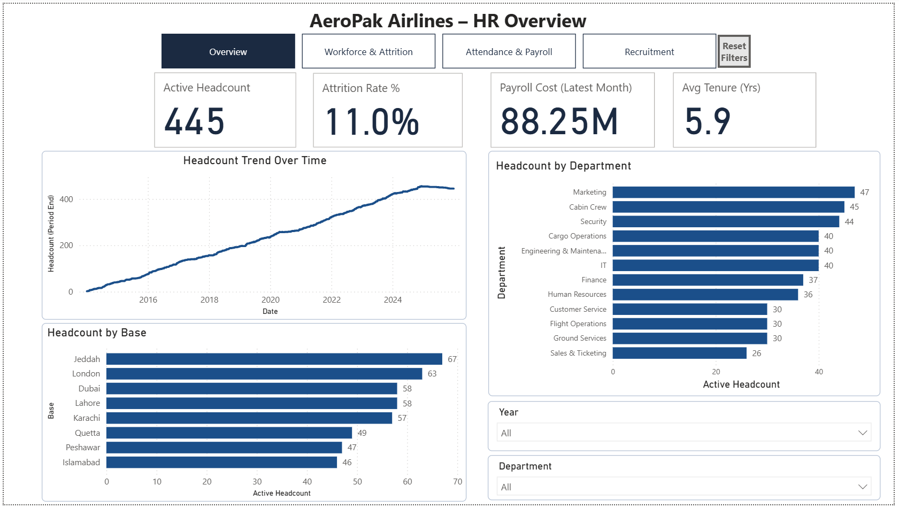
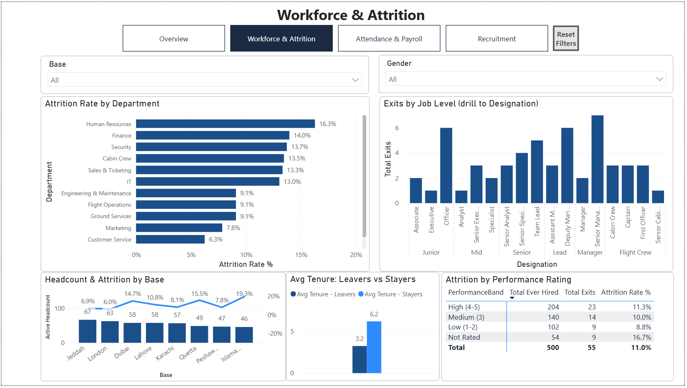
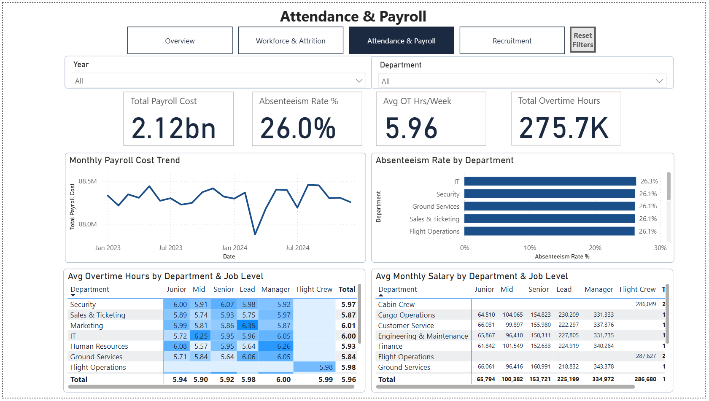
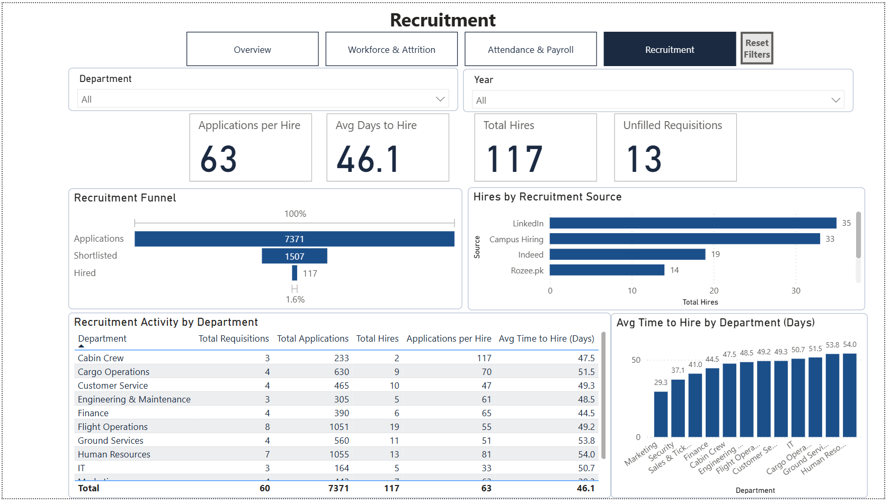
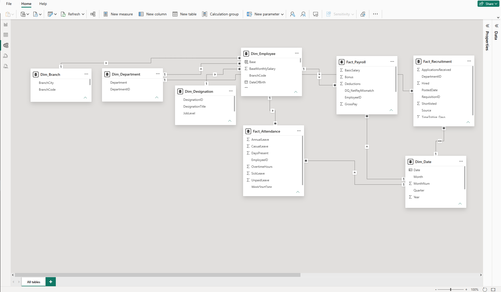

# ✈️ AeroPak Airlines — HR & Workforce Analytics (Power BI)

An end-to-end Power BI project analyzing headcount, attrition, attendance, payroll and recruitment for an airline workforce: data cleaning in Power Query, a star-schema model, DAX measures and a 4-page interactive report.

**Tools:** Power BI Desktop · Power Query (M) · DAX · Data Modeling  
**Dataset:** Simulated HR data for a fictional airline. 500 employees · 12 departments · 8 bases · ~46,000 weekly attendance records · ~10,700 monthly payroll records · 60 hiring requisitions

---

## 📊 Dashboard

### Page 1 — Overview

### Page 2 — Workforce & Attrition

### Page 3 — Attendance & Payroll

### Page 4 — Recruitment

---

## 🧹 Data Cleaning (Power Query)

| Issue | Fix |
|---|---|
| EmployeeID in three formats (`EMP-0001`, `emp0001`, `2001`) across tables | Standardized to one key format (`EMP-0001`) |
| Inconsistent Gender (`F`, `female`, `Female`) and EmploymentType (`PART TIME`, `full time`) values | Mapped to consistent categories |
| Stray spaces and all-caps names (`  USMAN JOHNSON  `) | Trimmed and set to proper case |
| Salary stored as numbers, `PKR 95,000` and `95,000.00` text | Removed text and commas, converted to decimal |
| 6 exact and 3 near-duplicate employee records | Removed, leaving 500 unique employees |
| Attendance rows for EmployeeIDs not in Dim_Employee | Removed after IDs were standardized |
| DaysPresent above 7 in a week | Treated as invalid |
| Blank Bonus, OvertimeHours and TimeToHire values | Handled with a stated rule per column (e.g. no hire means no time-to-hire) |
| NetPay not matching Basic + Bonus − Deductions | Flagged with a data-quality column |
| Data types | Set on every column across every table |

---

## 🗂️ Data Model

- Star schema with three fact tables (Fact_Attendance, Fact_Payroll, Fact_Recruitment) and five dimensions (Dim_Employee, Dim_Department, Dim_Designation, Dim_Branch, Dim_Date)
- One-to-many relationships with single-direction filtering
- Dim_Date marked as the date table and used for all time-based measures
- Job Level → Designation hierarchy for drill-down
- DAX measures for headcount, attrition, tenure, absenteeism, overtime, payroll and recruitment efficiency

---

## ⚙️ Report Features

- Page navigation buttons and a Reset Filters bookmark
- Custom tooltip page with department detail
- Drill-down from job level to designation
- Slicers on every page (year, department, base, gender)

---

## 🔍 Key Findings

- **445 active employees** out of 500 ever hired. 55 have left, an all-time attrition rate of **11.0%**.
- **Human Resources loses staff fastest** (16.3% attrition). Customer Service loses the fewest (6.3%).
- **Islamabad has the highest attrition of any base** (19.3%), while the two largest bases, Jeddah and London, have the lowest (6.9% and 6.0%).
- **Recruitment converts 1.6% of applicants:** 7,371 applications → 1,507 shortlisted → 117 hires, an average of 63 applications and 46 days per hire. 13 of 60 requisitions went unfilled.
- **LinkedIn (35 hires) and campus hiring (33)** are the most productive sources.
- **Overtime is spread evenly** at about 6 hours per week across departments and job levels.

---

## 📁 Files

| File | Description |
|---|---|
| `AeroPak HR Workforce Dashboard.pbix` | Power BI file: cleaned data, model, DAX measures and report |

---

## 👤 Author

**Salman Shahzad** — Data Analyst  

